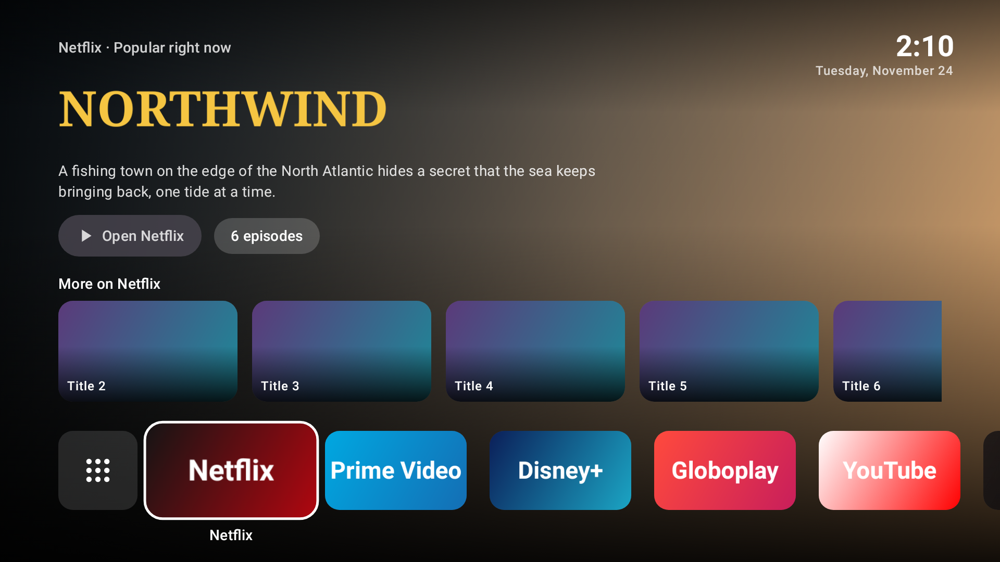
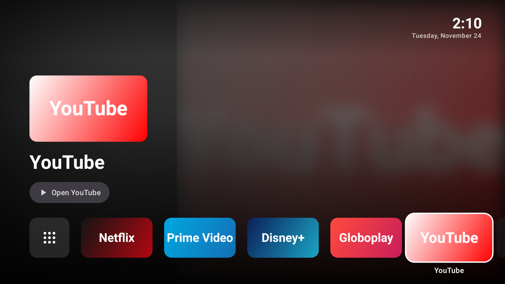
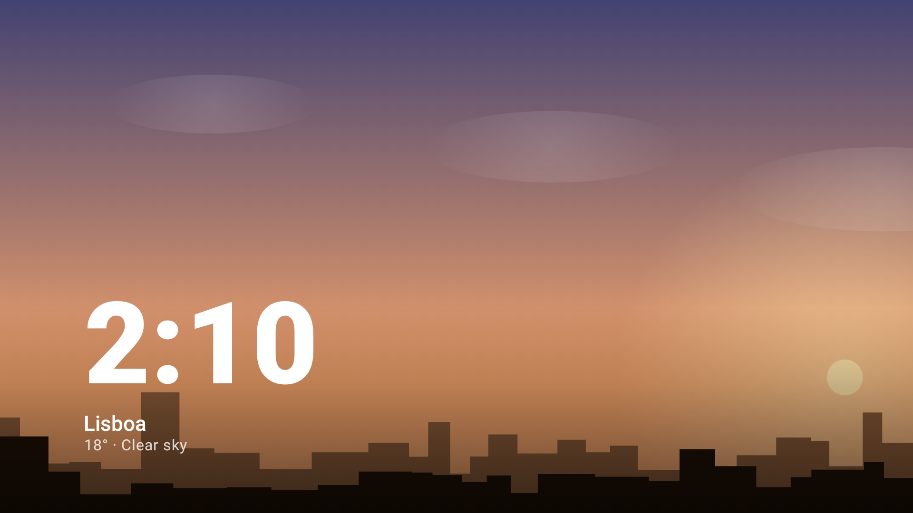
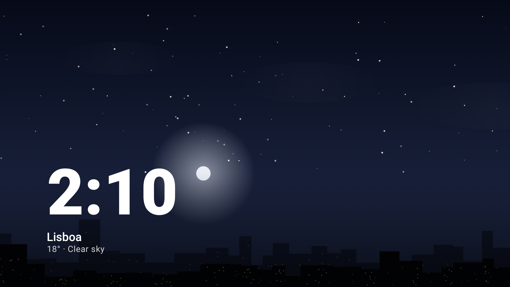

# Home TV: a custom home screen for Google TV

A replacement home screen (launcher) for Google TV / Android TV, inspired by the
"fix my cheap Google TV" idea: a full-screen hero that changes with the app you
highlight, a clean dock of apps, a clock, and an ambient screen with live weather.

| Home (streaming app) | Home (other app) |
|---|---|
|  |  |

| Ambient: sunset | Ambient: night |
|---|---|
|  |  |

*(These images come from the screenshot tests, which use fake apps and placeholder
posters. On the TV you see real app banners and real posters.)*

## What it does

- **Hero that follows the focused app.** Highlight Netflix, Prime Video, Disney+,
  Max, Globoplay, Apple TV or Paramount+ and the whole screen becomes the most popular
  title on that service in your country: backdrop, title logo, synopsis,
  "Open Netflix", episode count, and a row of more popular titles. Other apps get a
  background tinted with their colors.
- **Dock** of your favorite apps. The focused app grows and shows its name.
  Hold OK on an app for *Move left / Move right / Remove*.
- **All apps** (the ⋮⋮⋮ tile). Hold OK on any app to add it to, or remove it from,
  the dock.
- **Ambient screen** after a few idle minutes (configurable): a sky that follows the
  real sunrise and sunset for your city, clouds when it's cloudy, stars and lit
  windows at night, a big clock, the temperature and current conditions. The clock
  shifts slightly every minute so it can't burn into the screen. Press any key to
  leave it.
- English and Portuguese, following the TV's language.

## Data sources

- **Trending titles:** [TMDB](https://www.themoviedb.org/) "where to watch" data. It
  needs a **free** API key: create an account, then go to *Settings → API → Create*.
  Either the v3 "API Key" or the v4 "Read Access Token" works. Without a key
  everything else still works; streaming apps just show the plain tinted hero.
  "Popular" means TMDB popularity for titles on that service in your region. It is
  **not** Netflix's official Top 10, and launchers can't read your personal
  "continue watching" lists from other apps.
- **Weather:** [Open-Meteo](https://open-meteo.com/) (no key). Set your city in
  Settings.

## 1. Get the APK

**Option A, from GitHub (easiest).** Every push that touches `tv-launcher/` runs the
*Build TV launcher APK* workflow. Open the repo's **Actions** tab, click the latest
run, and download **home-tv-apk**. It's a zip containing `app-debug.apk`.
To bake your TMDB key into it, add a repository secret named `TMDB_API_KEY`
(*Settings → Secrets and variables → Actions*), then re-run the workflow.

**Option B, build it yourself.** You need JDK 17+ and the Android SDK (Android Studio
installs both).

```bash
cd tv-launcher
echo "TMDB_API_KEY=your_key_here" >> local.properties   # optional
./gradlew assembleDebug
# -> app/build/outputs/apk/debug/app-debug.apk
```

## 2. Install it on the TV

1. On the TV: *Settings → System → About*, then click **Android TV OS build** 7 times
   to unlock Developer options.
2. *Settings → System → Developer options*: turn on **USB debugging** (on some TVs
   it's called **Network debugging** or **Wireless debugging**).
3. Find the TV's IP address: *Settings → Network & Internet → (your Wi-Fi)*.
4. On a computer with [platform-tools](https://developer.android.com/tools/releases/platform-tools)
   (`adb`) on the same network:

```bash
adb connect 192.168.x.x:5555     # accept the prompt on the TV
adb install -r app-debug.apk
```

No computer? Install **Send Files to TV** or **Downloader** from the Play Store on
the TV, send the APK from your phone, and open it. You'll need to allow
"install unknown apps" for that app.

The app now appears in your apps list as **Home TV**. You can open it right away
to try it.

## 3. Make it the home screen

Google TV doesn't offer a menu to change the home app, so there are two routes.

**Route 1: disable the stock launcher (true replacement, reversible).**

```bash
adb shell pm disable-user --user 0 com.google.android.apps.tv.launcherx
adb shell pm disable-user --user 0 com.google.android.tungsten.setupwraith
```

Press **Home** on the remote. If Android asks which app to use, pick **Home TV**
and choose *Always*. On older Android TV models (not Google TV), the stock launcher
is `com.google.android.tvlauncher` instead.

To undo it at any time:

```bash
adb shell pm enable com.google.android.apps.tv.launcherx
adb shell pm enable com.google.android.tungsten.setupwraith
```

Caveats: with the stock launcher disabled you lose Google TV's own home-screen
features (recommendations, profiles, the "For you" tab). Some manufacturers ship
their own launcher package, and a system update can re-enable the stock one, in
which case you run the commands again. Disabling these packages is a common,
reversible tweak, but you do it at your own risk.

**Route 2: remap the Home button (no system changes).** Install
**Button Mapper** from the Play Store and set *Home → single press → open app →
Home TV*.

## First run

1. Highlight the ⚙ tile at the right end of the dock, then:
   - **City for weather**: type your city, e.g. `São Paulo`.
   - **Streaming region**: a country code such as `BR`, `PT` or `US`. It defaults to
     the TV's country.
   - **TMDB API key**: paste it here if it wasn't baked into the APK.
2. Open **All apps** (⋮⋮⋮) and hold OK on apps to choose your dock.

## Project layout

```
tv-launcher/
  app/src/main/java/com/beatriz/tvlauncher/
    MainActivity.kt          home activity, key handling, ambient wake-up
    LauncherViewModel.kt     state: apps, dock, feeds, weather, idle timer
    data/                    installed apps, TMDB, Open-Meteo, settings
    ui/HomeScreen.kt         hero + dock
    ui/AmbientScreen.kt      sky/clock/weather idle screen
    ui/AllAppsScreen.kt, ui/SettingsScreen.kt
  app/src/test/.../ScreenshotTest.kt   renders every screen to app/build/screenshots
```

Built with Kotlin and Jetpack Compose for TV. To re-render the screenshots after a
UI change, run `./gradlew testDebugUnitTest`.
